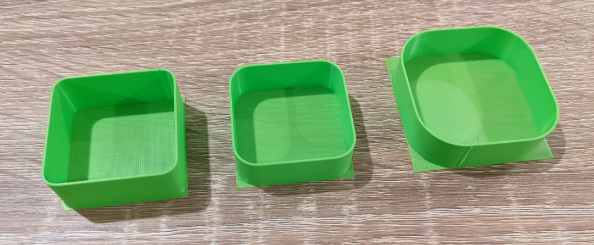
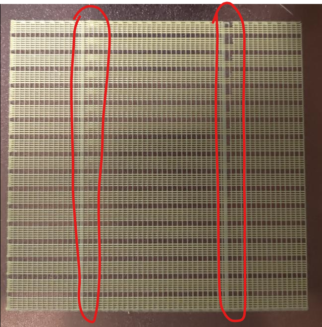
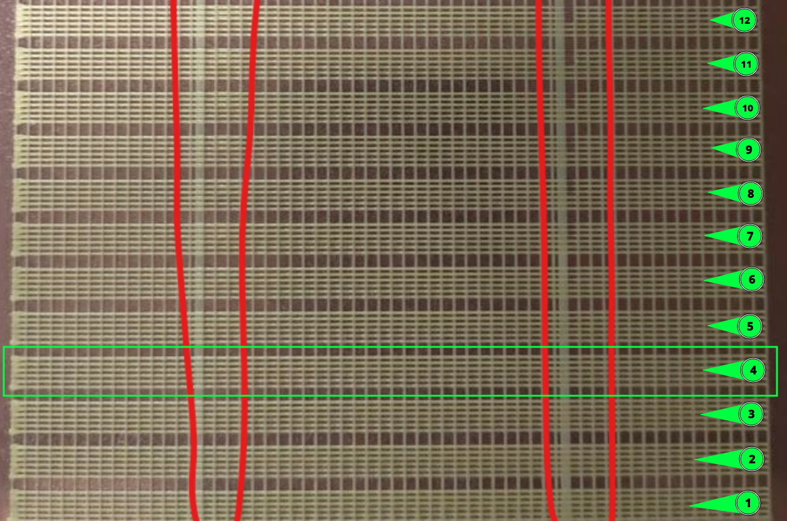

# Flow and pressure advance calibration

[Extra macros](README.md) · [Setup](setup.md)

## Prepare for calibration

Use the filament, nozzle and temperatures you intend to print with. Before calling a standalone flow or pressure advance macro, home the printer, perform your normal leveling/Z-offset preparation, load the appropriate bed mesh and heat the bed and nozzle. These two macros do not perform print startup or shutdown; use your printer's own preparation and finishing routine.

`CALIBRATE` wraps preparation, calibration and `END_PRINT`, but depends on a compatible `_USER_VARIABLES` macro and `START_PRINT`/`END_PRINT` accepting the arguments used in [calibrate.cfg](../../files/macros/extra/calibration/calibrate.cfg). It is not a universal stock-printer command.

For a configuration that meets those requirements:

```gcode
CALIBRATE TYPE=flow BED_TEMP=60 EXTRUDER_TEMP=210 MATERIAL=PLA
CALIBRATE TYPE=pressure_advance BED_TEMP=60 EXTRUDER_TEMP=210 MATERIAL=PLA
```

Run one calibration at a time and remove the previous print. The temperatures above are examples; select values suitable for your filament.

| Wrapper parameter | Default | Meaning |
| --- | --- | --- |
| `TYPE` | Required | `flow` or `pressure_advance` |
| `BED_TEMP`, `EXTRUDER_TEMP` | `_USER_VARIABLES` print defaults | Target temperatures in °C |
| `MATERIAL` | `ABS` | Material passed to `START_PRINT` |
| `TOOL` | `0` | MMU tool; an already loaded tool takes precedence when MMU is enabled |

The wrapper uses a 40 mm flow area with `EXTRUSION_WIDTH=0.471`, or a 120 mm PA area. It does not forward other tuning parameters: call the standalone macros for those.

## Flow: print, measure, calculate



1. Prepare the printer as above, then run `FLOW_MULTIPLIER_CALIBRATION` (or the flow wrapper).
2. Note the theoretical shell thickness reported in the console. After the print, measure the average wall thickness using a micrometer or caliper.
3. Supply your actual measurement in millimeters:

   ```gcode
   COMPUTE_FLOW_MULTIPLIER MEASURED_THICKNESS=0.78
   ```

4. Apply the reported **NEW COMPUTED FLOW VALUE** as the extrusion multiplier/flow ratio in your slicer. The macro only reports the value; it does not save a slicer setting.

Do not restart Klipper between printing and computing: the print's multiplier and theoretical thickness are stored in memory. If they are lost, provide `OLD_EXTRUSION_MULTIPLIER` and `THEORICAL_THICKNESS` as well, using the values from that print. The spelling `THEORICAL_THICKNESS` is intentional in this implementation.

The calculation is `new multiplier = theoretical thickness × old multiplier / measured thickness`.

### Flow parameters

Dimensions and filament lengths are millimeters; speeds are mm/s. Defaults below match the code in this repository.

| Parameter | Default | Purpose |
| --- | --- | --- |
| `DO_RAFT` | `1` | Print a supporting base; `0` disables it |
| `DO_RECTRACT` | `0` | Enable travel retraction with `1`; use this exact spelling, not `DO_RETRACT` |
| `PRINT_SIZE`, `HEIGHT` | `40`, `15` | Footprint size and shell height |
| `CORNER_RADIUS` | `8` | Rounded outer corners |
| `PERIMETERS` | `2` | Wall count; a single wall needs more precise measurement |
| `FAN_SPEED` | `20` | Part cooling percentage after the raft |
| `EXTRUSION_MULTIPLIER` | `1.00` | Multiplier used for the test |
| `FILAMENT_DIAMETER` | `1.75` | Filament diameter |
| `EXTRUSION_WIDTH`, `LAYER_HEIGHT` | `0.4`, `0.2` | Target line width and layer height |
| `CONTROL_SPEED`, `RAFT_SPEED` | `100`, `60` | Shell and raft speeds |
| `TRAVEL_SPEED`, `Z_LIFT_SPEED` | `200`, `20` | Travel and Z lift speeds |
| `RETRACT_SPEED`, `RETRACT_LENGTH` | `50`, `0.5` | Retraction speed and distance |
| `PURGE_MM` | `1` | Initial filament purge; `0` disables it |

The flow file includes `[gcode_arcs]` for its rounded corners. Check existing arc configuration when integrating it.

## Pressure advance: compare the bands



Prepare the printer and ensure `pressure_advance` is configured in `[extruder]`. Then run:

```gcode
PRESSURE_ADVANCE_CALIBRATION START=0.02 INCREMENT=0.005 DO_RAFT=1
```

Each band has slow control lines and test lines that change speed. Compare their widths where the test lines accelerate and decelerate. Choose the highest band from the bottom that still resembles its control lines without bulges or gaps.



**Number the bottom band 0.** Calculate:

```text
PA = START + INCREMENT × band_number
```

For band 4 with the command above, `PA = 0.02 + 0.005 × 4 = 0.040`. Set the result as `pressure_advance` in your extruder configuration. The macro restores the configured PA at completion; it does not save the selected result. Repeat with a narrower range and smaller increment if needed.

### Pressure advance parameters

Speeds are mm/s; dimensions and filament lengths are millimeters. This version assumes 1.75 mm filament and derives line dimensions from the configured nozzle diameter.

| Parameter | Default | Purpose |
| --- | --- | --- |
| `START`, `INCREMENT` | `0.02`, `0.005` | First band's PA and increase per band |
| `DO_RAFT` | `1` | Supporting raft; the parameter is not `RAFT` |
| `PRINT_SIZE` | `120` | Maximum pattern footprint |
| `BANDS_LIMIT` | `999` | Upper limit; available space also limits band count |
| `LINES_PER_BAND` | `6` | Control plus test lines; minimum 2 |
| `LINE_SPACING` | `0.4` | Base spacing, adjusted for extrusion multiplier |
| `EXTRUSION_MULTIPLIER` | `1.25` with raft, `1.5` without | Test-line extrusion multiplier |
| `CONTROL_SPEED` | `30` | Control-line speed |
| `OUTER_SPEED`, `INNER_SPEED` | `40`, `120` | Slow ends and fast middle of test lines |
| `RAFT_SPEED`, `TRAVEL_SPEED` | `120`, `200` | Raft and travel speeds |
| `RETRACT_LENGTH` | `0.6` | Retraction distance |
| `PURGE_MM` | `8` | Initial filament purge |

The macro warns that normal cancellation cannot interrupt its queued print reliably; use emergency stop if the test must be stopped immediately.
